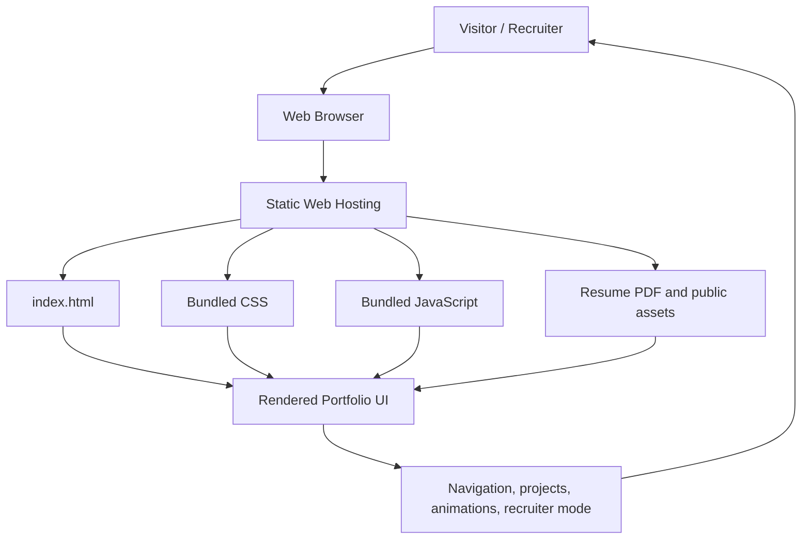
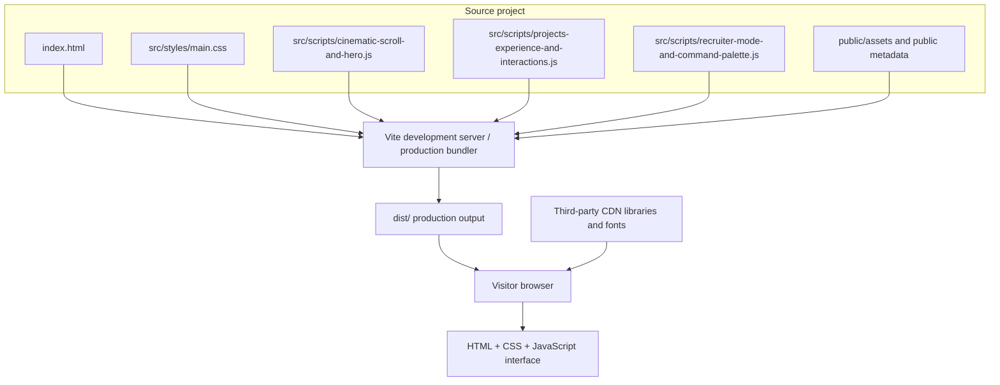
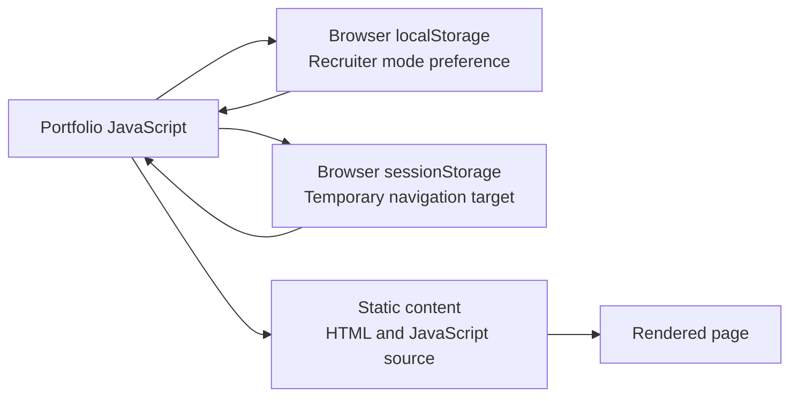
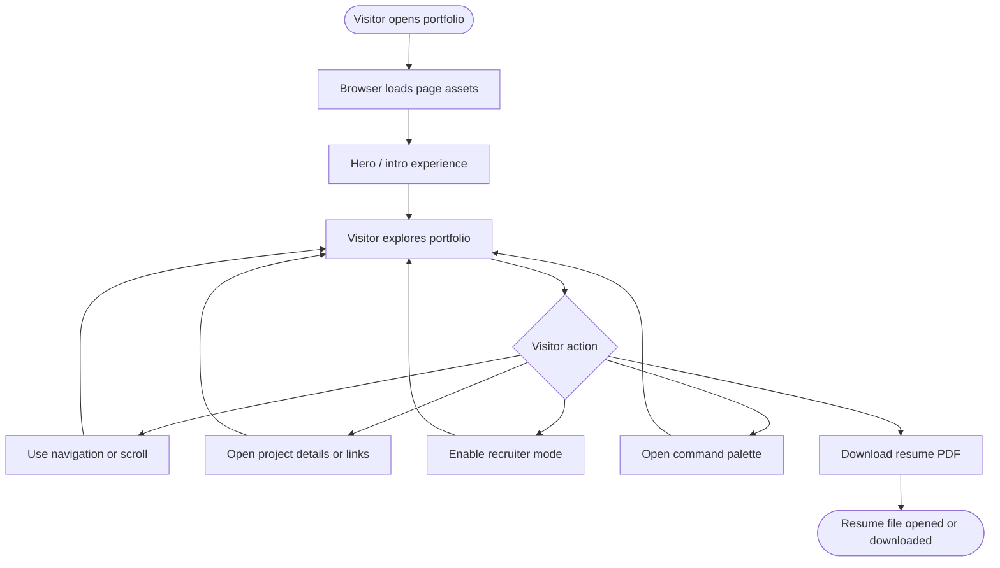

# Abhinav Gupta — Personal Portfolio

A responsive, interactive portfolio website presenting my profile, technical skills, selected projects, experience, and resume. The site is built as a static front-end application and uses Vite for local development and production bundling.

> **Repository:** `abhinav-gupta-portfolio`  
> **Status:** Portfolio project  
> **Deployment:** Add the live URL here after deployment.

---

## Contents

- [Overview](#overview)
- [Features](#features)
- [Technology stack](#technology-stack)
- [System block diagram](#system-block-diagram)
- [Application architecture](#application-architecture)
- [Data and database design](#data-and-database-design)
- [User interaction flow](#user-interaction-flow)
- [Project structure](#project-structure)
- [Run locally](#run-locally)
- [Build and preview](#build-and-preview)
- [Deployment](#deployment)
- [Quality checks](#quality-checks)
- [Notes and limitations](#notes-and-limitations)

## Overview

This portfolio is a static website. Vite serves the source during development and bundles the HTML, CSS, JavaScript, and public assets for production. The browser renders the interface and runs the site's interactions. There is currently no custom backend API or database connected to this portfolio.

## Features

- Personal introduction and profile sections
- Projects and experience showcases
- Responsive page layout
- Scroll-based and hero animations
- GSAP and ScrollTrigger-powered interactions
- Lenis smooth scrolling
- Recruiter mode
- Command palette and interactive project details
- Downloadable resume PDF
- SEO metadata, favicon, and `robots.txt`

## Technology stack

| Area | Technology |
|---|---|
| Markup | HTML5 |
| Styling | CSS3; Tailwind CDN utilities retained from the original page |
| Application logic | JavaScript (ES modules) |
| Development and build | Vite 6 |
| Animation | GSAP, ScrollTrigger, Draggable |
| Smooth scrolling | Lenis |
| Icons | Lucide |
| Audio interaction | Tone.js (browser audio requires a user gesture) |
| Fonts | Google Fonts and Open Sauce One CDN stylesheet |
| Hosting options | Vercel, Netlify, or Firebase Hosting |

## System block diagram



## Application architecture

The application follows a lightweight, static front-end architecture. There is no server-side application layer in this repository.



### Main front-end modules

| Module | Responsibility |
|---|---|
| `index.html` | Page structure, metadata, content, and module entry points |
| `src/styles/main.css` | Global styling, layout, responsive rules, and visual effects |
| `cinematic-scroll-and-hero.js` | Hero and cinematic scroll-related behaviour |
| `projects-experience-and-interactions.js` | Project, experience, and page interaction logic |
| `recruiter-mode-and-command-palette.js` | Recruiter mode, command palette, and related navigation behaviour |
| `public/assets/` | Static public assets, including the resume PDF |

## Data and database design

**This portfolio does not currently use a database.** It is a static front-end website, so a database ER diagram with tables and relationships would incorrectly imply that a database exists.

The only browser-side persistence identified in the source is Web Storage:

- `localStorage` stores the recruiter-mode preference.
- `sessionStorage` temporarily stores a recruiter-view navigation target.
- Portfolio content is defined in the HTML and JavaScript source; it is not loaded from a database.

The accurate data/storage view is therefore:



There are no database tables, database relationships, user accounts, or custom authentication service in this repository. Firebase mentioned in the portfolio content belongs to a separate showcased project, not to the portfolio website's own architecture.

## User interaction flow



## Project structure

```text
abhinav-gupta-portfolio/
├── index.html                         # Main page and metadata
├── package.json                       # Scripts and Vite dependency
├── package-lock.json                  # Generated by npm install (commit if present)
├── vite.config.js                     # Vite build configuration
├── .gitignore                         # Excludes dependencies and build output
├── README.md                          # Project documentation
├── DEPLOYMENT.md                      # Hosting instructions
├── TESTING-REPORT.md                  # Current verification notes
├── public/
│   ├── favicon.svg                    # Browser tab icon
│   ├── robots.txt                     # Search crawler directives
│   └── assets/
│       └── Abhinav_Gupta_Resume.pdf   # Downloadable resume
├── src/
│   ├── styles/
│   │   └── main.css                   # Main stylesheet
│   └── scripts/
│       ├── cinematic-scroll-and-hero.js
│       ├── projects-experience-and-interactions.js
│       └── recruiter-mode-and-command-palette.js
└── dist/                              # Generated by npm run build; not committed
```

`node_modules/` is generated by npm and is intentionally excluded from version control. `package-lock.json` is generated by `npm install`; commit it once generated so installs are reproducible.

## Run locally

### Requirements

- Node.js 20 or newer
- npm
- Git (for version control)

### Setup

```bash
git clone https://github.com/YOUR_GITHUB_USERNAME/abhinav-gupta-portfolio.git
cd abhinav-gupta-portfolio
npm install
npm run dev
```

Open the local URL printed by Vite in the terminal (usually `http://localhost:5173`).

## Build and preview

Run the JavaScript syntax checks and create an optimized production build:

```bash
npm run check
npm run build
```

Vite writes the deployable site to `dist/`. Preview that production build locally with:

```bash
npm run preview
```

## Deployment

For Vercel, import the GitHub repository and use:

| Setting | Value |
|---|---|
| Framework preset | Vite |
| Build command | `npm run build` |
| Output directory | `dist` |
| Install command | `npm install` |

Other hosting notes are available in [DEPLOYMENT.md](DEPLOYMENT.md).

## Quality checks

The project has been built successfully locally, and a Lighthouse run on the local production preview produced these results at the time of testing:

| Lighthouse category | Score |
|---|---:|
| Performance | 94 |
| Accessibility | 85 |
| Best Practices | 96 |
| SEO | 100 |

Scores can vary by browser, device, network, and Lighthouse version. Accessibility is the main area identified for further improvement. Re-run Lighthouse on the deployed URL before treating these as launch results.

## Notes and limitations

- No custom backend, database, or authentication system is part of this portfolio repository.
- Third-party scripts and font stylesheets are loaded from CDNs. Review and pin/self-host dependencies where practical before a high-assurance production launch.
- Tailwind is currently loaded through its CDN script; the browser console warns that the CDN approach is not recommended for production. Consider migrating the used utilities to a local Tailwind build or ordinary CSS.
- Browser audio APIs may require a user gesture before audio can start; this is browser policy, not necessarily a site failure.
- Add the final deployed domain to canonical and Open Graph URL metadata after deployment.
- Test the responsive layout on real mobile devices as well as browser emulation.

## Author

**Abhinav Gupta**  
GitHub: [@abhinavgupta30](https://github.com/abhinavgupta30)
